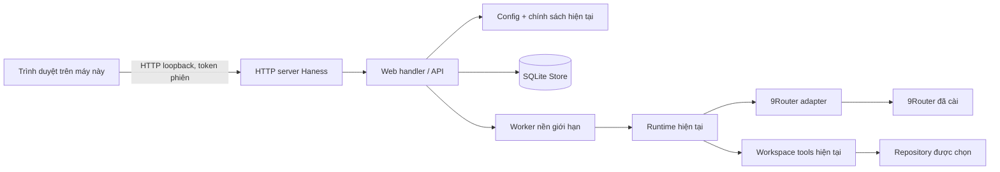

# Thiết kế: Web UI cục bộ cho Haness

Ngày: 2026-10-22  
Trạng thái: Được người dùng duyệt và triển khai ngày 2026-10-22

## Mục tiêu

Thêm giao diện trình duyệt để tạo và theo dõi coding task trong Haness đang chạy tại máy cá nhân. Giữ CLI hiện tại, cấu hình 9Router, quyền tool và SQLite data directory. Server chỉ nghe trên loopback; không triển khai dịch vụ công khai.

## Phạm vi bản đầu

- Trang tổng quan hiển thị workspace hiện tại, model đã cấu hình (không có API key), trạng thái kết nối gần nhất nếu kiểm tra được, và danh sách task.
- Tạo task bằng yêu cầu văn bản; nhận task ID/session ID và trạng thái.
- Xem trạng thái, thời gian, model thực tế, lịch sử sự kiện và nội dung trả lời.
- Dừng task đang chạy và resume task paused qua cùng Runtime hiện tại.
- Xem Git status/diff để người dùng rà soát thay đổi.
- Poll trạng thái định kỳ bằng HTTP; không cần WebSocket.
- Giữ CLI làm phương thức vận hành thay thế.

Ngoài phạm vi: chỉnh cấu hình 9Router trong UI, sửa file trực tiếp từ UI, bật command allowlist, lịch nền, đăng nhập từ xa, triển khai công khai, nhiều agent, và workflow triển khai.

## Hướng triển khai đã cân nhắc

1. **Python stdlib HTTP server và HTML/CSS/JS tĩnh — khuyến nghị.** Không thêm dependency hoặc build frontend; dùng trực tiếp Config, Store, Runtime và Tools. Phù hợp ứng dụng cá nhân một máy.
2. **Framework Python web (ví dụ FastAPI).** API thuận tiện hơn nhưng thêm package, khóa dependency và bề mặt bảo trì cho một giao diện cục bộ nhỏ.
3. **SPA riêng hoặc desktop shell.** Tách UI tốt hơn khi sản phẩm lớn, nhưng cần toolchain frontend hoặc runtime desktop và làm bootstrap phức tạp hơn.

## Kiến trúc

Server và worker ở cùng process; API handler không gọi model đồng bộ trong request HTTP. Bản đầu chỉ cho phép một task chạy tại một thời điểm để tránh đua nhau sửa cùng working tree. Task mới được lưu vào SQLite trước khi đưa vào worker. UI poll read-only endpoints để cập nhật tiến độ.

## API dự kiến

- `GET /api/status`: workspace, model chính, trạng thái server/worker; không trả secret.
- `GET /api/tasks`: danh sách task đã lưu.
- `POST /api/tasks`: tạo task; trả ID/session ID; không tự bật command execution.
- `GET /api/tasks/{id}`: task cùng events đã che secret.
- `POST /api/tasks/{id}/stop`: yêu cầu dừng tại ranh bước runtime; request provider đang chạy có thể kết thúc hoặc timeout trước đó.
- `POST /api/tasks/{id}/resume`: chỉ xếp tiếp khi worker trước đã dừng và các kiểm tra resume của Runtime đạt.
- `GET /api/workspace/status` và `GET /api/workspace/diff`: trạng thái/diff giới hạn đầu ra để review.

Mã lỗi API là JSON ổn định, không trả traceback, header provider hay nội dung credential.

## Giao diện

- Sidebar: tên workspace, tạo task, danh sách task và trạng thái.
- Khu vực chính: ô yêu cầu và chi tiết task đang chọn.
- Chi tiết task: trạng thái/ID/model, sự kiện theo thứ tự, câu trả lời cuối, nút Stop/Resume theo trạng thái, Git status/diff có thể mở rộng.
- Layout co giãn cho cửa sổ hẹp; thao tác bằng chuột/keyboard, nhãn form và trạng thái có thể đọc bằng screen reader. Không thêm animation cần thiết.

## An toàn và lifecycle

- Bind mặc định vào `127.0.0.1`; không bind `0.0.0.0`. In URL cục bộ khi khởi chạy.
- Mỗi lần chạy sinh token ngẫu nhiên trong bộ nhớ. HTML cùng origin nhận token; mọi mutation yêu cầu header token. Kiểm tra Host/Origin, không bật CORS, không đưa token vào URL hoặc log.
- Không render nội dung task/event như HTML; escape text để ngăn XSS lưu trữ từ phản hồi model/tool.
- API chỉ dùng workspace/data directory đã cấu hình. Giới hạn kích thước body và đầu ra diff/events.
- Command tool tiếp tục theo `AGENT_HARNESS_ALLOW_COMMANDS`, mặc định tắt. Path guard vẫn không cô lập subprocess khỏi quyền OS.
- Runtime hiện có trạng thái `running/paused`; server khôi phục task còn `running` sau khi process khởi động lại về `paused` để người dùng chủ động resume. Resume tiếp tục kiểm tra revision workspace và từ chối tool call chưa rõ kết quả.
- Giới hạn một worker; resume bị từ chối khi worker cùng task chưa thoát dù trạng thái DB đã chuyển paused.
- Đóng server không tự xóa hoặc reset SQLite. Task đang thực thi khi process bị tắt được xem như gián đoạn; hành động tool có kết quả không rõ phải được kiểm tra trước khi resume.

## Chạy và cấu hình

- Dùng cấu hình người dùng hiện tại `~/.haness-9router/config.env` và environment override; không hỏi lại hoặc ghi lại API key.
- CLI thêm lệnh `web` (hoặc launcher tương đương) với bind loopback mặc định và cổng mặc định có thể cấu hình bằng flag/environment. Nếu cổng bận, báo cách chọn cổng khác, không tự bind địa chỉ công khai.
- Cần cấu hình 9Router hợp lệ và router chạy khi tạo task. Việc mở trang UI không cần gọi model hoặc in secret.
- Bootstrap và lệnh CLI cũ vẫn hoạt động.

## Chấp nhận

1. Khởi chạy từ launcher hiện có và mở được UI chỉ qua loopback.
2. Tạo task, thấy task ID/status, events và kết quả; server không trả API key.
3. Stop/resume task và không lặp lại hành động tool đã hoàn thành; task có tool call dở dang bị chặn resume như quy tắc hiện tại.
4. Task chạy nền không chặn API status; không cho phép hai worker ghi đồng thời cùng workspace.
5. Request từ origin khác hoặc mutation thiếu token bị từ chối; nội dung model hiển thị dưới dạng text an toàn.
6. Hiển thị Git diff để review; diff bị giới hạn đầu ra.
7. CLI, doctor, cấu hình hiện tại và dữ liệu SQLite tiếp tục hoạt động.
8. Có kiểm tra tự động với provider giả; kiểm tra router thật được ghi riêng nếu môi trường cho phép.

## Rủi ro / câu hỏi đã quyết định

- Một tiến trình web cục bộ không phải sandbox: người có quyền cùng user và subprocess vẫn có thể truy cập như tài khoản chạy Haness.
- Không có xác thực người dùng độc lập; bảo vệ bằng loopback, token phiên, kiểm tra origin và chính sách trình duyệt. Không dùng trên máy chia sẻ như dịch vụ đa người dùng.
- Runtime chưa hỗ trợ hủy HTTP request đang bay; Stop là cooperative tại ranh bước, phù hợp hành vi CLI hiện tại.
- Chỉ một task chạy tại một thời điểm để tránh xung đột workspace trong bản đầu.
