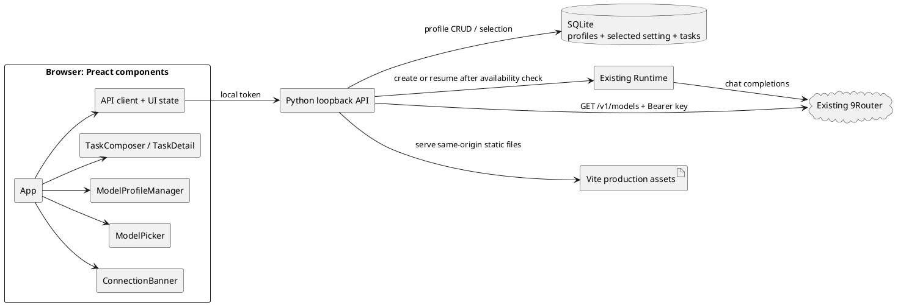

# Web UI Framework and 9Router Model Catalog

## Purpose

Move Haness's local web interface to a small component framework and add a reliable model-selection and local model-profile workflow. At startup, the UI must probe the configured 9Router endpoint and prevent model-dependent actions until that probe succeeds.

## Current environment and verified 9Router contract

- The target repository has no Git metadata. No worktree or commit can be created here.
- The execution environment is Linux x86_64 with Python 3.14.4, Node.js 24.18.0 and npm 11.16.0.
- Existing UI is static HTML/CSS/JavaScript served by the Python stdlib server. There is no frontend package manifest.
- A request using the existing local Haness configuration to `GET {base_url}/models` succeeded and returned 24 model IDs. The API key was not printed. `{base_url}/health` returned 404; do not use it as the connection probe.
- 9Router documentation describes `GET /v1/models` with `Authorization: Bearer ...` and `data[].id` as the model IDs consumed by requests. See [9Router troubleshooting](https://github.com/decolua/9router/blob/master/gitbook/content/en/troubleshooting.md) and the [9Router API skill](https://github.com/decolua/9router/blob/master/skills/9router/SKILL.md).
- Preact's project goals target a small runtime (approximately 3.5 kB); its official guide recommends Vite and documents production static builds. See [Preact goals](https://preactjs.com/about/project-goals/), [Preact getting started](https://preactjs.com/guide/v10/getting-started/) and [Vite production build](https://vite.dev/guide/build).

## Decisions

1. Use **Preact + Vite** for JSX components and a production static bundle. Compared with keeping vanilla JS, this supplies the requested component boundaries; compared with larger React or a new full-stack framework, the runtime stays small and the existing Python HTTP server remains the application server. Preact sources and build tooling are development-only: generated static assets ship in the repository, so launching Haness does not require Node.js or a CDN.
2. Split UI into focused components: `App`, `ConnectionBanner`, `TaskSidebar`, `TaskComposer`, `WorkspacePicker`, `ModelPicker`, `ModelProfileManager`, `TaskDetail`, `GitReview` and `Toast`. Put API calls and connection/model state in small service/hooks modules.
3. Probe 9Router with authenticated `GET /v1/models` at UI startup. Successful, valid model-list JSON is the connection signal. Do not use `/health` or issue a chat completion for the startup check.
4. While connection is checking or unavailable, disable model selection, task submission and task resume in the UI. Keep local-only navigation, stop, Git review, profile management and connection retry available. Enforce availability again at task-create/resume API boundaries so a stale or modified browser cannot bypass the UI gate.
5. The live 9Router list is read-only. Add/edit/delete applies to **Haness model profiles only**; it never changes or deletes router provider models. A profile stores a local display name and route model ID. The UI may save an ID from the connected catalog or enter a custom ID; an ID not present in the current live catalog cannot be selected for a task.
6. The composer selects a model per task and remembers the last selected model in Haness SQLite for the next new task. A task keeps its chosen model in its existing `tasks.model` field; resume uses that recorded value. CLI's environment-selected model is not changed by web preferences.
7. A profile may be created/edited/deleted without 9Router being online because those are local Haness data operations. A disconnected provider still blocks activating a model, submitting a task or resuming a task.

## Alternatives considered

- **Keep vanilla JavaScript:** smallest dependency footprint and no build step, but component boundaries would remain hand-built and stateful UI flows would keep growing in one script.
- **Lit:** very small Web Components runtime and natural browser integration, but JSX/component reuse is less familiar and framework conventions are less aligned with the current UI structure.
- **Preact + Vite (chosen):** small Preact runtime with explicit reusable JSX components; Vite emits static assets consumed by the existing Python server. Node is needed for UI development/build only, not when launching Haness.

## Data-first access patterns and representation

| Operation | Frequency / bound | Read or write |
|---|---:|---|
| Probe router and fetch catalog | UI startup, manual refresh, before submit/resume | One bounded HTTP GET; do not persist the volatile catalog |
| Read local model profiles and remembered model | UI startup and catalog/settings refresh | One SQLite query each; expected at most 200 profiles |
| Add/edit/delete a local profile | Infrequent user action | One SQLite transaction; no router mutation |
| Select model for next task | Per task or when remembered choice changes | Write one setting row; copy exact ID into task row on creation |
| Resume an existing task | Infrequent; reads existing row | Use stored task model and stored task workspace; revalidate that model against current live list |

Use SQLite as the durable source for Haness profiles and one active/remembered model setting. Store only stable IDs and user-facing labels; do not cache the full provider response or credentials. Proposed records:

- `model_profiles(id TEXT PRIMARY KEY, display_name TEXT NOT NULL, model_id TEXT NOT NULL UNIQUE, created_at TEXT NOT NULL, updated_at TEXT NOT NULL)`.
- `settings(key TEXT PRIMARY KEY, value TEXT NOT NULL)` with key `web.selected_model_id`.
- Existing `tasks.model` remains the model actually assigned to the task; no task table change is required.

P1 gates: reject blank/oversized names and model IDs; profile IDs and model IDs are unique; selected model must occur in a successfully fetched live catalog; task creation/resume fails closed when the catalog request fails or the selected/task model is absent. Removing a profile does not remove a router model or mutate prior tasks. Never log authorization headers or raw provider error bodies.

### Algorithm, complexity and bounded work

Parse only `data[].id` from the router response, reject responses over 1 MiB and catalogs over 1,000 entries, and keep the live IDs in an in-memory set for O(1) selected-model membership checks. The UI only receives the bounded ID list and up to 200 Haness profiles. SQLite lookups use the profile primary/unique keys and settings primary key; there is no full task-history scan on model selection.

## Component and request flow

## Error handling and connection gating

- The catalog API returns connected state, valid model IDs, local profiles, remembered selection, and a sanitized error category/message. Authentication failures, malformed responses, timeouts, provider unavailability and empty model catalogs have distinct user-visible states without exposing keys or provider response bodies.
- UI starts in `checking`; it does not optimistically enable task actions. On success, model selection and task actions become available only when a valid live model is selected. On failure, show a persistent disconnected banner and a retry action.
- Task submission and resume re-fetch or otherwise verify the live catalog on the server immediately before enqueueing. If the router becomes unavailable or the model disappears after startup, return a clear conflict/service error and keep the task unstarted/paused.
- Stop is cooperative and does not require a model connection. Model CRUD is local and does not write router configuration.
- In-flight task model IDs remain immutable; changing the remembered UI model affects new tasks only.

## Acceptance and tests

- Build production UI with locked npm dependencies; runtime serves generated same-origin assets with the existing token/CSP protections and no external CDN.
- Components render task/model state safely through text nodes; form controls and dialog are keyboard accessible and announce connection errors.
- Fake-provider tests cover model-list parsing, auth/network/malformed/empty failures and secret-safe errors.
- API tests cover local profile add/edit/delete, duplicate/invalid input, selected-model validation, task model pinning, and fail-closed task creation/resume while offline or when a model disappears.
- UI component tests cover initial checking, disconnected action lockout, recovery after retry, catalog selection, profile CRUD, and new-task model persistence.
- Regression checks: all existing Python tests, Python compile, locked frontend install/build/test, browser smoke in connected and fake-disconnected states. The live router contract was checked on this Linux execution host; Windows build/runtime remains unverified here.

## Deferred

No direct CRUD of 9Router models/providers, no multi-user authentication, no model capability inference, no provider catalog caching, and no changes to the 9Router installation or configuration.
